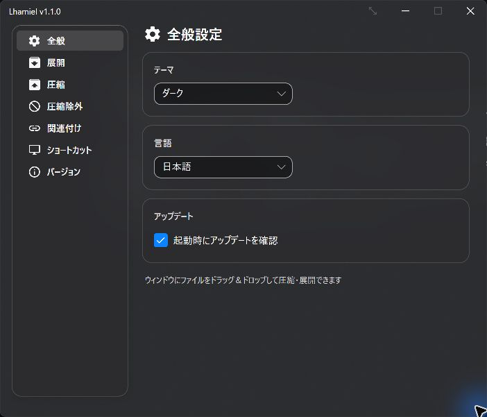
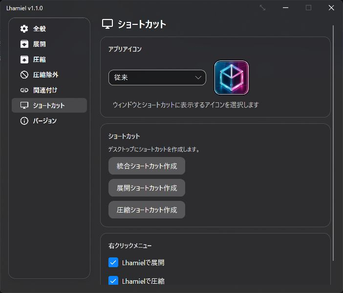

# Lhamiel

**ドラッグ＆ドロップと右クリックで使える、Windows向けアーカイブ圧縮・展開アプリ**

Lhamiel（ラミエル）は、ファイルやフォルダーを ZIP / 7z / TAR / LZH に圧縮し、ZIP・7z・RAR・LZH などのアーカイブを展開するアプリです。パスワード保護、圧縮対象の除外ルール、同名ファイルの競合解決に対応し、Windows x64 / ARM64 で利用できます。

全般設定（v1.1.0・ダークテーマ）

ショートカット設定（v1.1.0・ダークテーマ）

## 主な特徴

ドラッグ＆ドロップ、右クリック、AES-256 のパスワード保護、除外ルール、同名ファイルの競合解決、自動更新、17言語に対応します。詳細は[主な特徴](docs/readme/section-01.md)を参照してください。

## インストール方法

1. 最新の `Setup.exe` をダウンロード（Cloudflare R2 配信、固定 URL のため常に最新版が落ちてきます）
   - **x64**: <https://lhamiel.kagayoi.com/Lhamiel-win-Setup.exe>
   - **ARM64**: <https://lhamiel.kagayoi.com/Lhamiel-win-arm64-Setup.exe>
2. `Setup.exe` を実行してインストール
3. デスクトップやスタートメニューから Lhamiel を起動

## アンインストール方法

Windows の「設定」→「アプリ」→「インストールされているアプリ」から「Lhamiel」を選択し、「アンインストール」を実行してください。スタートアップ登録、Lhamiel の右クリックメニュー、Lhamielが設定したファイル関連付けはアンインストール時に自動で解除されます。

## システム要件

| 項目 | 内容 |
|------|------|
| **OS** | Windows 10 / 11 (x64, ARM64) |
| **ランタイム** | 不要（ネイティブ AOT ビルド、.NET 11） |
| **権限** | 一般ユーザー権限で動作 |

## 使い方

1. Lhamiel を起動
2. ファイルやフォルダー、またはアーカイブをウィンドウにドロップ
3. すべてが対応アーカイブなら展開、それ以外は圧縮を開始

右クリックやショートカットからの操作は[使い方](docs/readme/workflow.md)を参照してください。

### 設定

設定画面の変更は即時適用されます。各タブの内容と圧縮除外ルールは[設定](docs/readme/configuration.md)を参照してください。

## 対応形式

圧縮は ZIP / 7z / TAR / LZH、展開は RAR・CAB・ARJ なども対応します。[対応形式](docs/readme/section-06.md)を参照してください。

## 対応言語

システムの言語から自動検出し、設定でも変更できます。[対応言語](docs/readme/section-07.md)を参照してください。

## 更新について

起動時・手動・Windowsログイン時に更新を確認します。停止方法は[更新について](docs/readme/section-08.md)を参照してください。

## トラブルシューティング

展開の失敗、ログの場所、自動更新の問題などは[トラブルシューティング](docs/readme/section-09.md)を参照してください。

説明書の一覧: https://github.com/1llum1n4t1s/Lhamiel/tree/main/docs/readme

## 更新履歴

バージョンごとの変更点は [CHANGELOG.md](CHANGELOG.md) を参照してください。

## 連絡先

- **メール:** 1llum1n4t1@duck.com
- **利用上のお問い合わせ・不具合:** アプリの「設定」→「バージョン」→「お問い合わせフォームを開く」から送信できます。メール認証後に受付状況を確認でき、ほかの利用者の問い合わせは表示されません
- **開発者向けの技術課題・コントリビューション:** https://github.com/1llum1n4t1s/Lhamiel/issues

## ライセンス

Lhamiel は MIT License の下で公開されています。

Copyright (c) 2025-2026 ゆろち

詳細は [LICENSE](LICENSE) ファイルをご参照ください。

設定画面には Microsoft Fluent UI System Icons（MIT License）を使用しています。著作権表示と許諾文は、アプリの「バージョン」タブのライセンス表示、または[アイコンのライセンス](src/Lhamiel/Resources/FluentSystemIcons/LICENSE.txt)で確認できます。
